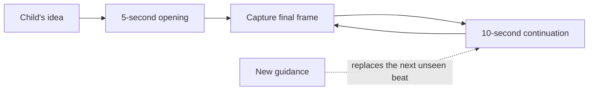

# Storytime

An endless animated bedtime story that children steer with their voice.

Storytime listens for the child's idea, turns it into a safe story beat, and begins generating a MiniMax H3 Max movie immediately. The story keeps moving on its own until the child says what should happen next. New guidance changes the next beat without cutting off the clip already playing.

## Demo

https://github.com/user-attachments/assets/48bba979-9c30-438c-871c-73c37431bff3

## The experience

1. The child tells Niko and Moss where to go or what to do.
2. Storytime creates a **5-second opening** as quickly as possible.
3. While that clip plays, the next **10-second continuation** is generated from its final frame.
4. Ten-second continuations keep generating automatically, with no questions or pauses.
5. If the child speaks again, the current clip finishes normally and the next clip follows the new direction.
6. The movie ends only when the child explicitly asks it to stop.

If a continuation is still rendering, the player holds the previous clip's final frame instead of looping or flashing an empty screen.

## Why it feels continuous

Each generated clip ends in a stable pose. Storytime captures that final frame and uses it as the visual reference for the next H3 Max image-to-video request. A persistent Story Bible reinforces the same characters, environment, palette, and illustration style on every generation.



Only two clips are kept in the active pipeline: the one being shown and the one being prepared. This keeps the experience responsive without generating a long queue that may no longer match the child's idea.

## Features

- Realtime speech-to-speech storytelling with fal Grok Voice
- Typed guidance when a microphone is unavailable
- MiniMax H3 Max text-to-video opening and image-to-video continuations
- Automatic 5s → 10s → 10s rolling generation at 480p
- Child guidance applied at natural clip boundaries
- Consistent characters and scenery through final-frame conditioning
- Non-looping playback with a last-frame hold during generation
- Stale unseen work discarded after new guidance
- Child-safety filtering before visual prompts are submitted
- Reduced-motion and keyboard-accessible controls
- Local in-memory sessions with no database setup

## Quick start

### Requirements

- Node.js 22
- Corepack
- Chrome or Edge
- A [fal API key](https://fal.ai/dashboard/keys)

```sh
git clone https://github.com/gokayfem/h3-bedtime-story.git
cd h3-bedtime-story
corepack enable
corepack prepare pnpm@11.21.0 --activate
pnpm install --frozen-lockfile
cp .env.example .env
```

Add your key to `.env`:

```dotenv
FAL_KEY=your-fal-key
```

That is the only environment value required for the local app.

```sh
pnpm dev
```

Open [http://localhost:3000/learn](http://localhost:3000/learn), allow microphone access, and tell Niko and Moss how their story should begin.

> Run `pnpm dev` from the repository root. The root command loads `.env` before starting the web app.

## Generation pipeline

The speech model produces short, chronological narration beats. Application code then owns continuity, safety, duration, and queue behavior:

1. `H3PromptCompiler` checks the requested action and combines it with the Story Bible.
2. The opening is submitted to `minimax/h3-max/text-to-video` for five seconds at 480p.
3. Its final frame becomes the `image_url` for `minimax/h3-max/image-to-video`.
4. Every continuation is ten seconds and ends with a stable two-second pose.
5. Generation uses `sync_mode: false`, allowing the returned CDN video to begin loading normally.
6. The director preloads the next clip and swaps it in only after the visible clip ends.
7. New child guidance replaces unseen work, never the clip already on screen.

The generated H3 prompt follows a stable shape:

```text
STORY BIBLE: recurring characters, setting, palette, and storybook style

STORY BEAT: what changes now
NARRATIVE PURPOSE: why this moment matters
ACTION: distinct character actions and a visible environmental consequence

Create the requested duration with a setup, committed action, visible result,
and a stable two-second ending pose that can begin the next beat.
```

## Project structure

```text
apps/web                 Next.js experience and fal video director
apps/realtime-gateway    Optional stateful realtime gateway
packages/domain          Story prompting, safety, and domain rules
packages/protocol        Shared session and tool contracts
packages/persistence     In-memory and optional durable adapters
packages/science-eval    Legacy deterministic evaluation utilities
database/migrations      Optional PostgreSQL migrations
deploy                   Optional production deployment configuration
```

The default local experience uses the Next.js app and in-memory storage. The gateway, PostgreSQL, and Redis adapters are present for production-scale deployments but are not needed to try Storytime.

## Commands

```sh
pnpm dev             # run the self-contained Storytime app
pnpm lint            # lint every workspace package
pnpm typecheck       # run TypeScript checks
pnpm test            # run unit and integration tests
pnpm test:coverage   # run tests with coverage thresholds
pnpm build           # create production builds
pnpm check           # lint, typecheck, test, and build
```

## Security and privacy

- `FAL_KEY` stays on the server and must never use a `NEXT_PUBLIC_` prefix.
- `.env`, generated output, caches, certificates, and learner data are ignored by Git.
- Browser requests receive only narrowly scoped, short-lived authorization where required.
- Voice audio is sent to fal while the microphone is active.
- Visual prompts and continuity frames are sent to fal for video generation.
- Local session state is held in memory and disappears when the process exits.

Before a public child-facing deployment, review the included privacy and terms pages and configure appropriate consent, retention, authentication, quotas, and durable storage policies.

## License

No license has been granted yet. Add a license before redistributing or accepting external contributions.
